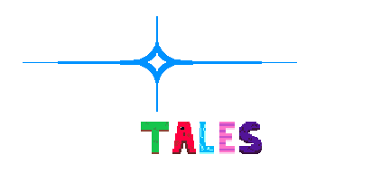

<h1 align="center">Magic Tales</h1>

  

  🧩 Plataforma e puzzles em 2D · 🎮 Godot 4.6 · 💻 GDScript

## ✨ Sobre o jogo

Em **Magic Tales**, você alterna entre dois personagens para resolver puzzles e atravessar oito fases divididas em quatro mundos. Um deles corre mais rápido e salta mais alto. O outro pode lançar magia para destruir blocos quebráveis.

Empurre caixas, acione alavancas e placas de pressão e use as cargas de magia que encontrar pelo caminho. Para avançar, você precisa encontrar a chave e levar os dois personagens até a saída.

## 🎮 Controles

| Tecla | Ação |
| --- | --- |
| `A` / `D` | Mover para a esquerda / direita |
| `W` / `S` | Subir / descer escadas |
| `Espaço` | Pular |
| `F` | Alternar entre os personagens |
| `E` | Interagir com elementos do cenário |
| Botão esquerdo do mouse | Lançar magia na direção do cursor com o segundo personagem, quando houver cargas |
| `Esc` | Pausar / retomar o jogo |

## 🚀 Como jogar

### Pelo Godot

1. Instale o [Godot 4.6](https://godotengine.org/download/archive/4.6-stable/).
2. Clone este repositório ou baixe e extraia o ZIP do código-fonte.
3. No gerenciador de projetos do Godot, importe o arquivo `project.godot`.
4. Abra o projeto e pressione `F5` para iniciar o jogo.

### No Windows

Se você tiver a versão exportada, mantenha `Magic Tales.exe` e `Magic Tales.pck` na mesma pasta e abra o executável.

## 📁 Estrutura do projeto

| Pasta | Conteúdo |
| --- | --- |
| [`Cenas/`](Cenas/) | Menu, telas e fases do jogo |
| [`Entidades/`](Entidades/) | Cenas reutilizáveis de personagens, objetos e armadilhas |
| [`Scripts/`](Scripts/) | Código em GDScript para movimentação, puzzles, câmera e interface |
| [`Sprites/`](Sprites/), [`Tiles/`](Tiles/) e [`Fontes/`](Fontes/) | Arte e recursos visuais |
| [`Shaders/`](Shaders/) e [`Sons/`](Sons/) | Efeitos visuais e áudio |
